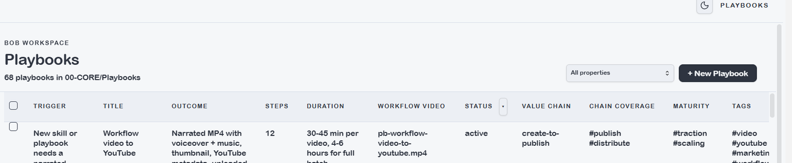
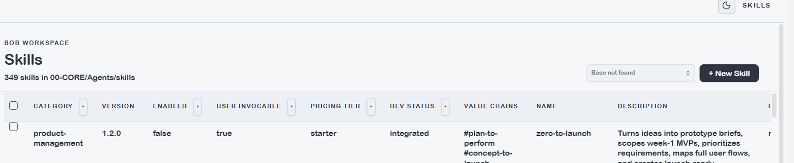

# AI Workspace

The AI Workspace section surfaces the skill and playbook library directly inside the plugin — browse, search, and launch workflows without leaving Obsidian.

---

## Playbooks

Playbooks lists all `type: playbook` notes from the vault. Each entry shows the playbook name, trigger phrase, estimated duration, total steps, and status. Clicking a playbook opens a detail view with the full trigger, outcome, and step-by-step workflow.

Key fields in a playbook:
- **Trigger** — the phrase or condition that starts this playbook
- **Outcome** — what you get when the playbook completes
- **Total steps** — number of discrete skill invocations in the workflow
- **Value chain** — which business value chain this playbook serves

Use the search bar to filter playbooks by name or trigger. The status filter shows only `active` playbooks by default — set to *All* to include drafts and archived playbooks.

**To launch a playbook**: copy the trigger phrase and paste it into the Claude Code chat panel. The assistant matches the trigger to the playbook and begins execution.

---

## Skills

Skills lists all `type: skill` notes from the vault. Each entry shows the skill name, category, version, development status, and which value chains it serves.

Key fields visible in the list:
- **Category** — the functional area (e.g. finance, crm, obsidian, content)
- **Dev status** — `draft / integrated / certified`
- **Pricing tier** — which product pack includes this skill
- **Value chains** — which end-to-end business journeys this skill supports
- **Requires** — any prerequisites (`none / config / api-key / mcp / install`)

Use the search bar to find skills by name or category. The status filter defaults to enabled skills only.

**To use a skill**: open the Claude Code chat and type the skill's trigger phrase or `/skill-name`. Skills with `disable-model-invocation: true` are infrastructure tools — they run via scripts rather than direct AI invocation.

