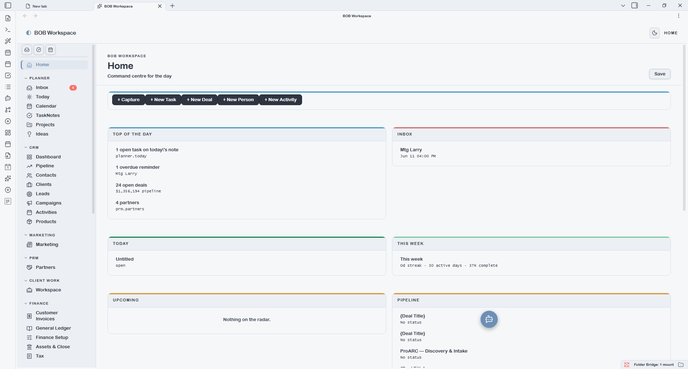
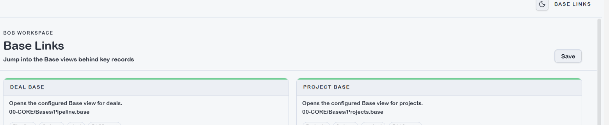

# BOB Workspace — User Guide

BOB Workspace is the operating interface of the BOB system inside Obsidian. It brings every business function — planning, CRM, client delivery, finance, procurement, reporting, and AI workflows — into a single plugin panel with a left-nav and tabbed sub-views. All data stays in plain markdown files with YAML frontmatter; the plugin is purely a lens over your vault.

---

## Navigation

| Section | What it covers |
|---------|----------------|
| [Planner](planner.md) | Daily planning — inbox, today, calendar, tasks, projects |
| [CRM](crm.md) | Pipeline, contacts, clients, leads, campaigns, activities |
| [PRM — Partner Relationships](prm.md) | Partner overview, registrations, commissions, certifications |
| [Client Work](client-work.md) | Client workspace: meetings, comms, deliverables, feedback, surveys, testimonials, decisions |
| [Finance](finance.md) | Invoicing, general ledger, finance setup, tax |
| [Suppliers & Procurement](procurement.md) | Suppliers, supplier invoices, purchase requisitions, purchase orders |
| [Reports](reports.md) | Productivity, pipeline, sales, partner, and activity reports |
| [AI Workspace](ai-workspace.md) | Playbooks browser and skills library |

---

## How the Plugin Reads Your Data

BOB Workspace resolves entity fields and views through four layers, applied in order. Later layers override earlier ones — no code changes required.

### Layer 1 — Built-in fallback model
Defined inside `main.js`. Keeps the plugin functional in an empty vault. Contains default field names for compatibility but should not be relied on for vaults with a configured datamodel.

### Layer 2 — Schema layer
YAML files in `{vault.schemas.source}`. The primary source for field keys, labels, types, enums, and required flags. When schemas are active, create forms, entity tables, and workbook export/import all use your vault's field names.

### Layer 3 — Base layer
`.base` files in `{vault.bases}`. Define *how* entities are displayed: visible columns, filters, sort order, groupBy, and named views. The plugin reuses these views rather than duplicating logic internally.

### Layer 4 — Custom entity overrides (`entities.json`)
Located at `.obsidian/plugins/bob-workspace/entities.json`. Use this to add new entity types, override built-in fields, change folder/type filters, or add local enum values — without touching schemas. Managed from **Settings → BOB Workspace → Custom entities** or reloaded with the **Reload entities.json** command.

---

## The Bases Dropdown

Most entity list screens show a **dropdown in the top-right** that lets you switch between named views defined in the corresponding `.base` file.

Each Base can define multiple named views with their own filters, column order, sort, and groupBy. Examples:

- Contacts Base might have views: *All Contacts*, *Business Contacts*, *By Company*
- Pipeline Base might have views: *Kanban*, *Active Deals*, *Won This Quarter*

**To change what appears in the dropdown:**
1. Open the relevant `.base` file in `{vault.bases}`
2. Add or edit a `views:` entry with a `name:`, optional `filters:`, `order:`, and `groupBy:`
3. Save — the dropdown updates immediately without restarting Obsidian

---

## What You Can Customise Without Touching Code

| What | How |
|------|-----|
| Entity field names, labels, enums | Edit `{vault.schemas.source}/{entity}.yaml` |
| Column visibility and order on list screens | Edit the `views:` block in `{vault.bases}/{Entity}.base` |
| Filters and grouping on list screens | Edit `filters:` / `groupBy:` in the Base view |
| Add a new entity type | Create schema YAML + Base file + `entities.json` entry |
| Override a built-in entity's folder or fields | Add an entry in `entities.json` |
| Team view categories | **Settings → BOB Workspace → Team person categories** |
| Task mode for Productivity | **Settings → BOB Workspace → Task mode** (checkbox / TaskNotes / hybrid) |
| TaskNotes folders | **Settings → BOB Workspace** — active folder + archive folder |
| Which modules appear in the nav | **Settings → BOB Workspace → Modules** — toggle Planner / CRM / PRM |
| Currency | **Settings → BOB Workspace → Currency** |
| Default tab on open | **Settings → BOB Workspace → App → Default tab** |
| Week start day | **Settings → BOB Workspace → App → Week starts on** |
| Daily note folder and headings | **Settings → BOB Workspace → App** |

**Template files are automatically excluded** — any file inside a path segment named `Templates` or `templates` is ignored by all entity lists and dashboards.

---

## Shared UI Patterns

These UI patterns appear consistently across entity list screens throughout the plugin.

**`+ New [Entity]` button** — opens a two-column capture modal. Fields are type-aware: date pickers, dropdowns for enum fields, required fields marked. Press Enter to save, Esc to cancel.

**Import CSV** — available on list views. Maps spreadsheet columns to entity fields by name (with synonyms). Override mappings before import. Each row becomes one `.md` file.

**Bases view dropdown** — top-right of entity list screens. Switches between named views defined in the entity's `.base` file. Adding a new view to the Base file adds it to this dropdown instantly.

**Secondary tabs** — screens for Campaigns, Partners, Client Work, General Ledger, Finance Setup, Tax, and Suppliers each have a tab strip. The first tab is always an overview/dashboard; subsequent tabs are entity sub-lists.

---

## Home

The Home screen is your command centre. It opens by default when you launch the plugin (configurable in Settings). It shows a two-column dashboard:

**Left column:** today's tasks (tickable inline), this week's progress, upcoming deadlines.

**Right column:** top active projects with milestone progress, pipeline summary by stage, partners due for follow-up, recent activity feed.

Home is read-only — tick tasks and they write back to the source daily note or TaskNote. Everything else opens its source note on click.

---

## Team

Team is a filtered People view — not a separate entity type. It shows `type: person` records filtered to the categories configured under **Settings → BOB Workspace → Team person categories**. The default categories are `employee`, `freelancer`, and `contractor`.

To add a new team member, use **+ New Person** and set `person_category` to one of the configured categories. To show additional person categories in the Team view (e.g. `advisor`), add it to the setting — no schema or code change needed. 

---

## Base Links

Base Links is a shortcut panel that surfaces direct links to every `.base` file in `{vault.bases}`. Clicking a link opens the Base in Obsidian's native Base viewer.

Use Base Links when you want to:
- Browse an entity list with inline editing (native Base views support inline field editing; plugin grid rows open the source note instead)
- Share a specific entity view with a colleague who prefers the native editor
- Quickly navigate to a Base file to add or edit named views

---

## Settings

Settings controls all plugin-level configuration. Changes take effect immediately without restarting Obsidian.

Key sections:

- **Modules** — toggle Planner, CRM, PRM on/off. Disabled modules disappear from the nav and from dependent Report screens.
- **App** — open on startup, default tab, week start day, daily note folder, task/journal heading names.
- **Task mode** — how Productivity and TaskNotes reads tasks: *Checkbox only* (daily note checkboxes), *TaskNotes only*, or *Hybrid*.
- **Team person categories** — which `person_category` values appear in the Team view.
- **Custom entities** — load or reload `entities.json` for entity overrides.
- **Currency** — display currency for deal values and invoice amounts.
- **Reminders** — enable desktop notifications, clear completed reminders.
