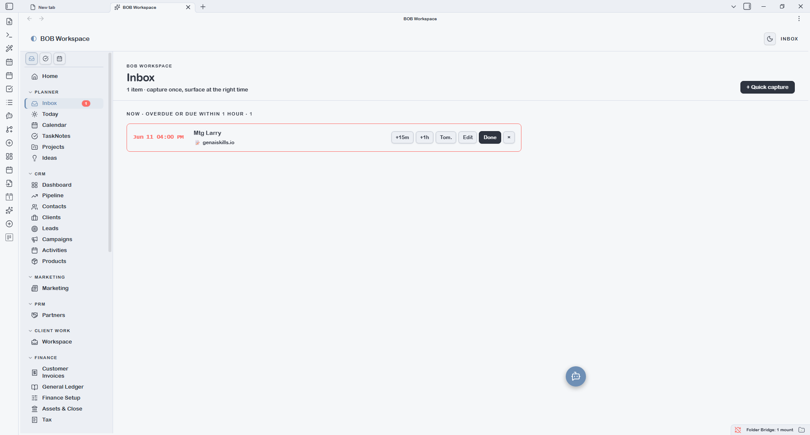
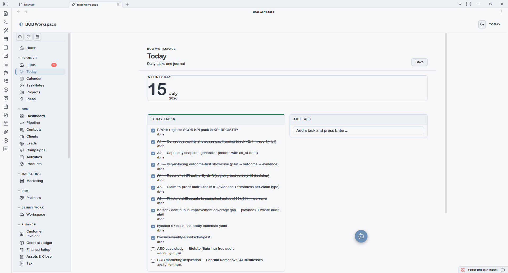
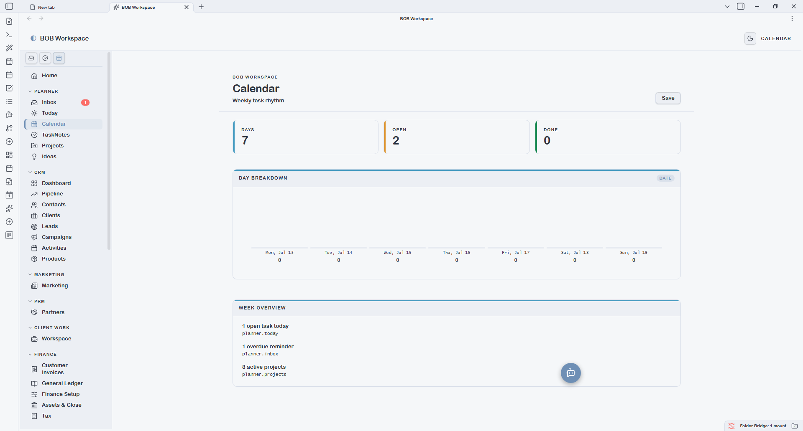
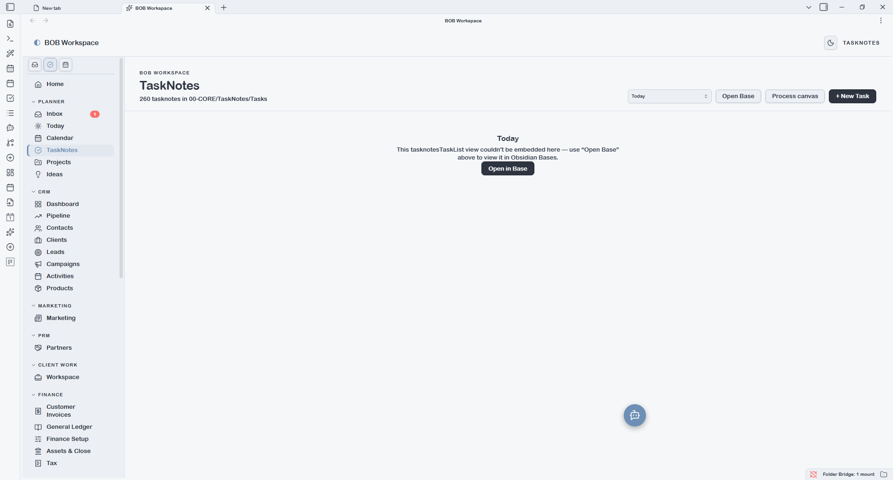
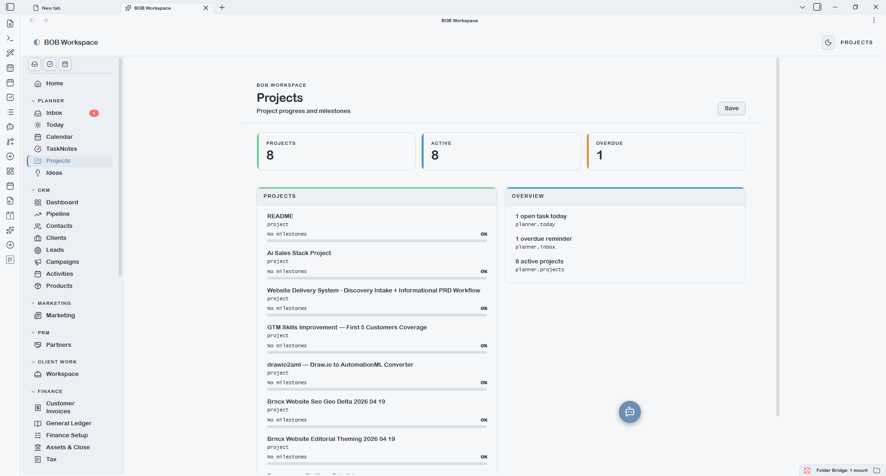

# Planner

The Planner module covers your personal operational loop — capturing items, planning today, navigating your week, and managing projects. It can be toggled off via **Settings → Modules** if not needed.

---

## Inbox

The Inbox is the universal capture and reminder surface. Every item you capture lands here first, grouped by urgency:

- **Now / Overdue** — items past their due time, shown in red
- **Due Today** — items due later today
- **This Week** — items due within the current week
- **Later** — everything else

Items have quick-action buttons: snooze (+15m, +1h, Tomorrow), mark Done, or Edit. The nav badge on the Inbox item shows the live count of overdue and due-now items.

**Quick capture** is available via `Ctrl+Shift+I` (Windows/Linux) at any time — opens a modal where you type a title, optionally set a datetime, and optionally set a repeat cadence (daily/weekly). Captured items write to a markdown file in the configured reminders folder.

---

## Today

Today is a diary view of your current daily note. It shows the note's content in a live-editable surface — the journal textarea autosaves as you type. A **+ Quick task** button appends a new task to the configured tasks heading in today's daily note.

The daily note folder and the heading names for tasks and journal sections are all configurable under **Settings → App**.

If today's daily note doesn't exist yet, Today creates it from your configured daily note template.

---

## Calendar

Calendar is a Mon–Sun week grid spanning your daily notes. Each day column shows the tasks from that day's note, tickable inline. Clicking a day heading opens that daily note.

The week start day (Monday or Sunday) is configurable under **Settings → App → Week starts on**.

---

## TaskNotes

TaskNotes lists your active task notes from the configured TaskNotes folder (`{output.tasks}` by default). Each row is a single TaskNote file; status, priority, due date, and project links are read from frontmatter.

The active folder and the archive folder are both configurable under **Settings → BOB Workspace**. The archive folder feeds the Productivity report's historical completion view.

The **Bases dropdown** reflects any named views defined in `{vault.bases}/task.base` — for example separate views for open tasks, in-progress, or tasks grouped by project.

---

## Projects

Projects shows a card grid of all `type: project` notes, grouped by status. Each card displays the project name, client, priority, deadline, and a colour-banded milestone progress bar.

Clicking a card opens the **Project Detail surface** — a full PM view with:
- Status, priority, owner, and due date pills at the top
- Left column: tickable milestones (date + title) and task list, each with `+ Add` buttons
- Right column: Brief, Scope, Risks, Stakeholders, and Notes — all autosaving textareas that write back to the H2 sections of the underlying note
- **Open as note** button to edit the full markdown body in Obsidian's editor

The **Bases dropdown** reflects named views in `{vault.bases}/project.base` — for example views filtered by status or grouped by client.

