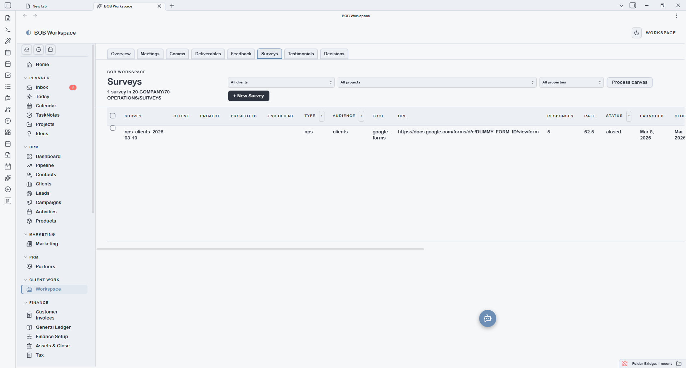
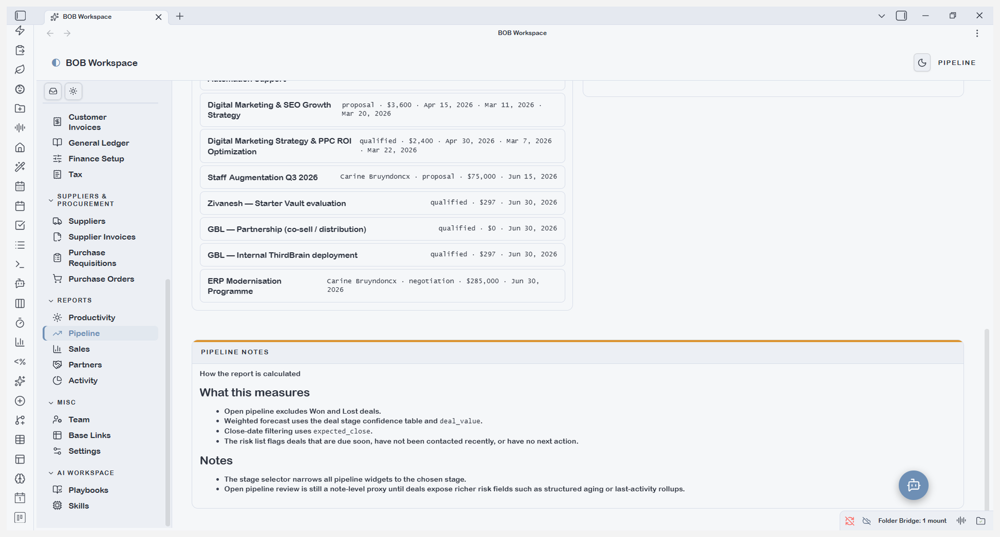

# Reports

Reports are read-only aggregated views across your vault data. They do not have their own entity files — they query existing records in real time. Report screens appear or disappear based on which modules are active in **Settings → Modules**.

---

## Productivity

Aggregates task completion history. What is included depends on the **task mode** configured in **Settings → BOB Workspace**:

- **Checkbox only** — reads checkbox tasks from daily note task sections
- **TaskNotes only** — reads TaskNote files from the active TaskNotes folder and the archive folder
- **Hybrid** — combines both sources

Shows tasks completed per day/week, completion rate, and tasks by project. The archive folder is included so historical completion remains visible even after tasks are archived.

---

## Pipeline

Aggregates all `type: deal` notes into a pipeline performance report. Shows:
- Deal count and total value by stage
- Win/loss ratio over a configurable date range
- Average deal size and average time-to-close
- Deals by owner (if `owner` field is populated)

---

## Sales

Aggregates closed-won deals and paid invoices into a sales performance report. Shows:
- Revenue recognised by period
- Top clients by revenue
- Deal source breakdown (how deals were originated)
- Revenue vs. target if targets are configured

---

## Partners

Aggregates PRM data into a partner performance report. Shows:
- Deals influenced per partner
- Commission totals paid and pending
- Registration conversion rates
- Certifications active vs. expired

Only visible when the PRM module is enabled.

---

## Activity

Aggregates all `type: activity` notes into an activity report. Shows:
- Activity count by channel (call, email, meeting, etc.)
- Activity by contact and by deal
- Inbound vs. outbound split
- Activity trend over time

Use this to monitor outreach volume and identify contacts or deals that have gone quiet.

