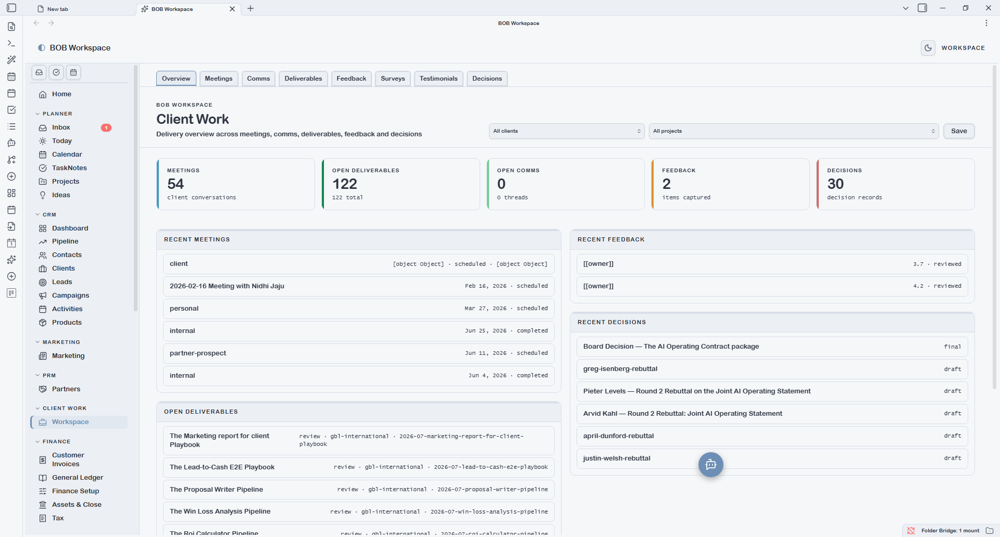
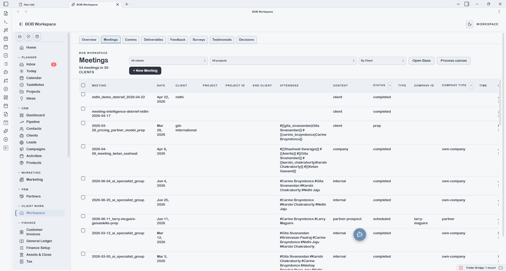
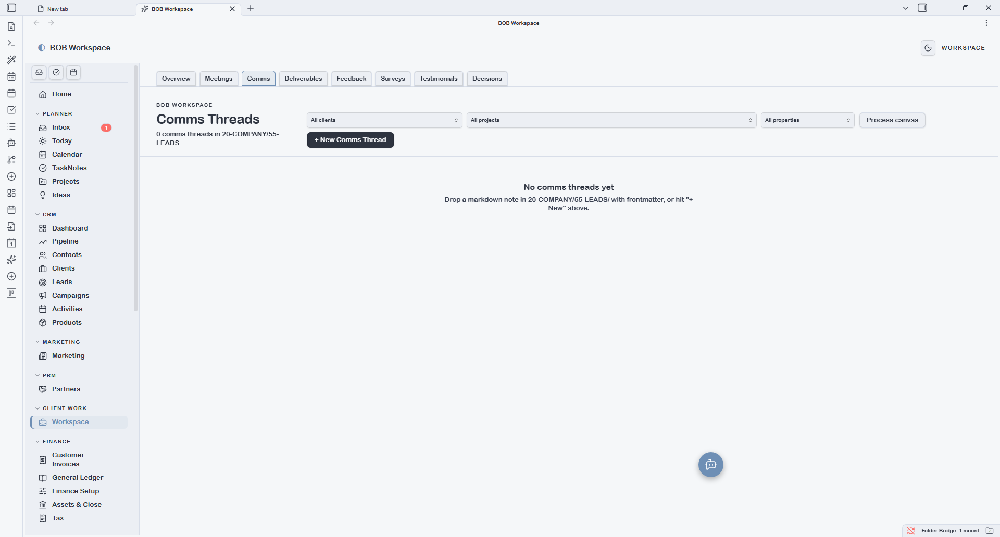
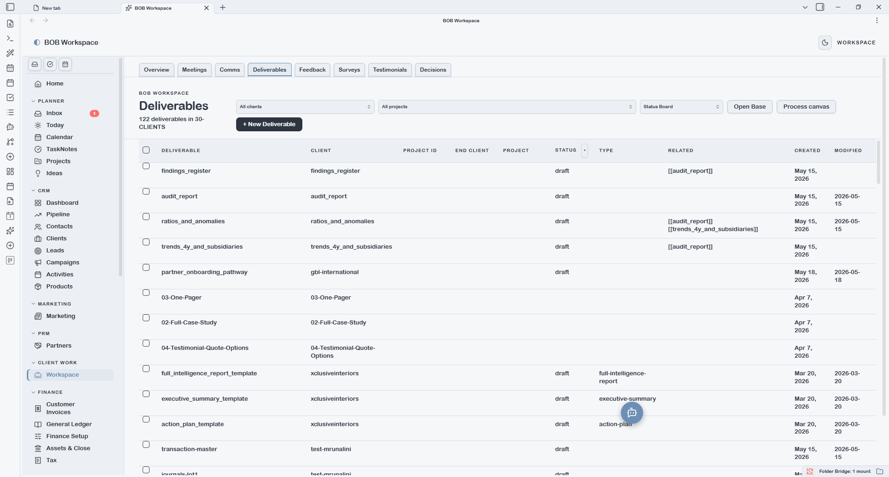
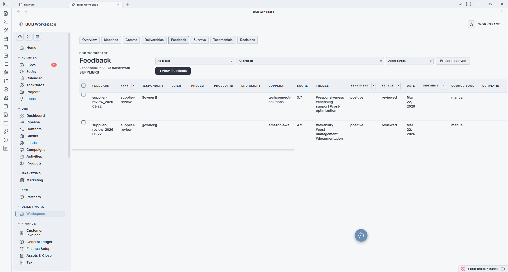

# Client Work

Client Work is the delivery workspace. It combines eight entity types into a single tabbed surface filtered by client and project. Unlike other sections which show all records vault-wide, Client Work is designed to be scoped — you pick a client and optionally a project, and all tabs filter accordingly.

---

## Overview

The Overview tab shows a summary for the selected client/project: open deliverables, recent comms, upcoming meetings, pending feedback, and active surveys. Use the **client selector** (top-left) to scope all tabs to a specific client. Use the **project selector** (next to it) to narrow further to a single project.

Selectors match on both `client_id` and `end_client_id` (for sub-contracting scenarios), and `project_id` for project scoping. Selecting *All clients* or *All projects* clears the respective filter.

---

## Meetings

Lists all `type: meeting` notes filtered by the selected client/project. Key fields: date, attendees, context, status. Status lifecycle: `scheduled → completed / cancelled`.

The **Bases dropdown** reflects `{vault.bases}/meeting.base`. Add views for *Upcoming*, *By project*, or *This month*.

---

## Comms

Lists all `type: comms-thread` notes for the selected client. Tracks ongoing communication threads (email threads, WhatsApp chains, portal messages). Key fields: channel, subject, status, last message date, awaiting reply flag.

The urgency indicator and `awaiting_reply` flag make it easy to spot threads that need a response.

---

## Deliverables

Lists all `type: deliverable` notes for the selected client/project. Status lifecycle: `draft → review → approved → delivered`.

The **Bases dropdown** reflects `{vault.bases}/deliverable.base`. Add views like *In review* or *Overdue* to monitor delivery health.

---

## Feedback

Lists all `type: feedback` notes for the selected client. Covers NPS, CSAT, exit surveys, and interview notes. Key fields: feedback type, respondent, score, themes, sentiment, date.

---

## Surveys

Lists all `type: survey` notes linked to the selected client. Key fields: survey title, type, target audience, tool, external URL, response count, response rate, status.

---

## Testimonials

Lists all `type: testimonial` notes for the selected client. Key fields: respondent, format (text/video/audio), permission level, use cases, published locations.

The permission level field (`public` / `attributed` / `anonymous`) controls what can be shared externally. Add a Base view filtered to `permission_level: public` to quickly find usable social proof.

---

## Decisions

Lists all `type: decision` notes scoped to the selected client/project. Tracks key decisions made during delivery — what was decided, by whom, and why — for audit and handoff purposes.

