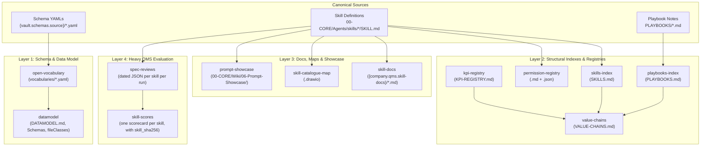

# BOB Vault Mechanics: Build Targets & Generated Artifact Dependencies

This document details the build targets, single-writer pipeline, and dependency relationships that govern the BOB (Business Operating Brain) vault infrastructure.

---

## 1. Single-Writer Architecture & Change Detection

The BOB vault operates without a git workflow for its runtime content. Integrity is maintained via a **content-hash manifest** (`20-COMPANY/01-QMS/corpus-integrity/manifest.json`), tracking SHA-256 digests of all declared inputs and outputs.

- **Rule:** Every generated artifact in the vault has **exactly one writer**.
- **Change Detection:** Staleness is determined by hashing `inputs`, never by filesystem `mtime` (which can be reset across an entire tree during bulk frontmatter updates).
- **Execution:** Running `corpus_check --build` evaluates the dependency graph and automatically rebuilds whichever targets are `STALE` or `NEW`.
- **Safety Gate:** If an output has changed while its declared inputs remain identical, the target enters the `EDITED` state. `corpus_check --build` refuses to overwrite hand-edited outputs, protecting against accidental loss.

```
       Canonical Source Files (YAML, SKILL.md, Playbooks, Profiles)
                                   │
                                   ▼
                   [corpus_check --build / --check]
             Evaluates SHA-256 inputs against manifest.json
                                   │
                                   ▼
         13 Registered Build Targets (Rebuilt in Dependency Order)
                                   │
                                   ▼
    Derived Vault Artifacts (Indexes, JSON Schemas, Docs, Registries, Maps)
```

---

## 2. The 13 Registered Build Targets

| Target | Description & Inputs | Outputs / Writes |
|---|---|---|
| `datamodel` | Compiles source entity models (`{vault.schemas.source}/*.yaml`) and vocabulary definitions via `regenerate.py`. | `DATAMODEL.md`<br>`DATAMODEL-FULL.md`<br>`FRONTMATTER-REQUIRED.md`<br>JSON Schemas (`{vault.schemas}/json-schema/*.json`)<br>Obsidian fileClasses (`{vault.schemas}/fileClasses/*.md`) |
| `open-vocabulary` | Extracts and normalizes accepted open-vocabulary terms from entities across the vault. | `{vault.schemas}/vocabularies/*.yaml` (derived enum values used by downstream schema generators) |
| `kpi-registry` | Parses KPI definitions across all value chains and operating domains. | `{company.management}/KPI-REGISTRY.md` |
| `skills-index` | Catalogs all active skills across `00-CORE/Agents/skills/`. | `SKILLS.md` |
| `playbooks-index` | Catalogs all business playbooks across the vault. | `PLAYBOOKS.md` |
| `value-chains` | Maps skills, playbooks, and KPIs across the 12 business value chains. | `VALUE-CHAINS.md` |
| `skill-docs` | Generates standardized reference and usage documentation for every registered skill. | `{company.qms.skill-docs}/*.md` (one documentation file per skill) |
| `prompt-showcase` | Formats and indexes client- and user-facing prompt templates and workflows. | The client-facing showcase pages in the Wiki (`00-CORE/Wiki/06-Prompt-Showcase/`) |
| `skill-catalogue-map` | Visualizes the entire skill catalog hierarchy and execution pipelines as Draw.io architecture diagrams. | `00-CORE/Wiki/03-Learn/Examples/SKILL-CATALOGUE-MAP.drawio`<br>`00-CORE/Wiki/03-Learn/Examples/SKILL-PIPELINE-MAP.drawio` |
| `permission-registry` | Audits every skill for tool declarations, environment variables, network access, and execution footprint. | `{company.operations}/SYSTEMS/integration-permission-registry.md` + `.json` |
| `spec-reviews` | Evaluates skills against QMS specification standards and outputs individual run results. | `{company.qms.spec-reviews}/individual/*.json` (one dated file per skill per run) |
| `skill-packs` | Generates the department skill-pack catalogue from each skill's `pricing-tier` through the department-pack mapping. | `SKILL-PACKS.md` |
| `skill-scores` | Scores skill maturity and execution health, recording tamper-resistant SHA-256 hashes. | `{company.qms.scores}/*.md` (scorecards carrying `skill_sha256`) |

---

## 3. Dependency Order & Pipeline Timing



### Why Full Builds Take 20+ Minutes
While layers 1 through 3 execute in seconds, **`spec-reviews`** and **`skill-scores`** account for almost the entire build duration:
- thousands of spec-review JSON files across runs (one dated file per skill per run)
- one scorecard per skill
- Each skill requires deep static parsing, link checks, and cryptographic scoring.

### Targeted Rebuilds
To avoid a 20-minute cycle during iterative development, use surgical target scoping with `--only`:

```bash
# Inspect registered targets
uv run 00-CORE/Agents/skills/corpus-integrity/scripts/corpus_check.py --list

# Rebuild only the data model and schema outputs
uv run 00-CORE/Agents/skills/corpus-integrity/scripts/corpus_check.py --build --only datamodel

# Rebuild indexes only
uv run 00-CORE/Agents/skills/corpus-integrity/scripts/corpus_check.py --build --only skills-index,playbooks-index,value-chains --skip-assertions
```

*(Note: Pre-release validation requires an unscoped, full `--build && --check` run exiting with code 0).*
